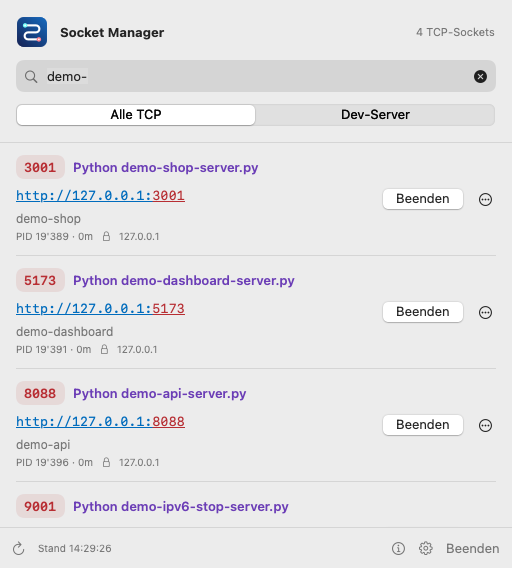
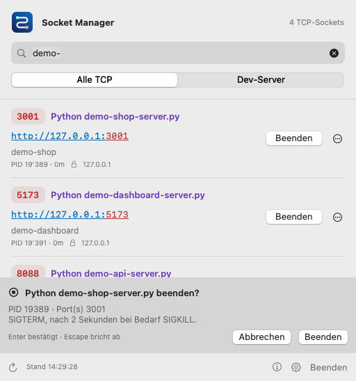
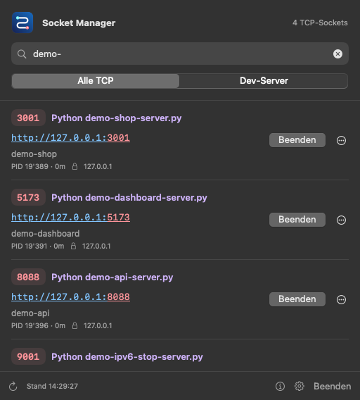

# Socket Manager

A small native macOS menu bar app for finding, opening, and stopping local TCP services. Built for everyday development: see the port, process, project, and URL without opening a terminal.

Source code and issue tracker: [samuelheinrich/socketmanager](https://github.com/samuelheinrich/socketmanager).



## What it does

- Runs as a custom icon in the menu bar, with no Dock window.
- Lists listening TCP sockets with a red port badge, purple application name, project, PID, uptime, and bind address.
- Opens a service through a full, underlined URL: blue address, red port. The whole URL is clickable.
- Provides a visible **Beenden** button beside each service. Click once, then press **Enter** to confirm inside the dropdown; **Escape** cancels.
- Keeps the dropdown open while stopping, shows progress, and refreshes the list so the service disappears in place.
- Offers **Alle TCP** and **Dev-Server** views plus filtering by port, process, project, command, or path.
- Copies URLs, opens HTTPS explicitly, reveals the project in Finder, and supports immediate termination through the secondary menu.
- Shows an Info window with the logo, version, author, contact address, and source link.
- Offers optional launch at login and a 3, 5, or 10 second refresh interval.

The app interface is in German. The original Python terminal tool is included too.

## Requirements

- macOS 15 or newer.
- Apple's Command Line Tools with Swift 6 or newer to build. Install them with `xcode-select --install` if needed.
- No Python, Xcode application, or third-party libraries are needed to run the native app.
- Python 3 is needed only for the terminal tool, disposable demo servers, and integration tests.

## Build, install, and run

Clone the repository, then build and install:

```sh
git clone https://github.com/samuelheinrich/socketmanager.git
cd socketmanager
./macos/scripts/install.sh
```

The script builds a release bundle, generates the icon, signs it locally, copies it to `~/Applications/Socket Manager.app`, and launches it. Click the circuit-shaped **S** icon in the menu bar.

To update an installed copy, quit the running Socket Manager through its menu before running the install script again. Installation refuses to overwrite a different app with the same filename.

For a build without installation:

```sh
./macos/scripts/build-app.sh
open "dist/Socket Manager.app"
```

The build targets the architecture of the current Mac. The app uses SwiftUI for its content and AppKit for the status item, popover, keyboard handling, and auxiliary windows. It has no external package dependencies.

## Open a service

Click the visible URL, such as `http://127.0.0.1:3001`. It opens in the default browser. IPv6 loopback URLs appear as `http://[::1]:9001`.

Opening assumes HTTP, except for ports 443 and 8443, which use HTTPS. Use **… → Mit HTTPS öffnen** for another TLS port. The app does not send background HTTP probes; a listening TCP socket is not necessarily a web server.

The **…** menu also offers URL copying and opening the working directory in Finder. Long names and URLs truncate in the middle; hover for details.

## Stop a service

1. Click **Beenden** directly on the row.
2. Read the confirmation inside the dropdown. It identifies the process and its other ports, or the entire Docker container.
3. Press **Enter** or click the confirmation button. Press **Escape** to cancel.



Normal termination sends SIGTERM. If the process remains alive after two seconds, Socket Manager escalates to SIGKILL. **… → Sofort beenden** skips that grace period and still asks for confirmation. Stopping a process affects all sockets it owns, not just the selected port. SIGKILL can discard unsaved work.

Confirmation stays within the popover rather than opening a separate modal alert. The popover stays open through the operation and the following refresh. Clicking outside or clicking the menu bar icon still closes it normally. Repeated Enter key events cannot submit additional stop operations.

### Process and Docker protections

- The app checks PID, user identity, and process start time, including microseconds, before signalling. Reusing a PID cannot turn an old row into permission to stop a new process.
- The selected listening port is rechecked immediately before signalling.
- The app, its parent-process chain, PID 1, and processes it cannot signal are protected.
- Docker-owned ports are matched to published **TCP** ports from `docker ps`. Mappings with multiple candidate containers for the same host port are disabled.
- Containers stop through `docker stop` or `docker kill`, using their container ID after revalidation. The Docker daemon is never directly signalled.
- Without an unambiguous container mapping, the Docker stop action is disabled.
- Stop results append to `~/.local/state/socketmanager.log`.

Docker mappings are covered with simulated output; stopping a real Docker container has not been verified on a running daemon.

## Settings and Info

The gear opens a real settings window. **Beim Anmelden starten** uses Apple's `SMAppService`; it is off by default. If macOS requires approval, the settings provide a link to Login Items.

The list refreshes only while its dropdown is open. The view choice and refresh interval persist locally. There are no telemetry, accounts, or remote monitoring services.

The **ⓘ** button opens **Über Socket Manager**, with the version, custom logo, author, email link, and GitHub source. The contact is also shown in Settings.



## Keyboard shortcuts

| Key | Action |
| --- | --- |
| `⌘F` | Focus the socket filter |
| `⌘R` | Refresh now |
| `⌘,` | Open Settings |
| `Enter` | Accept a pending stop confirmation |
| `Escape` | Cancel a pending confirmation; otherwise close the dropdown |
| `⌘Q` | Quit Socket Manager |

Native buttons and menus also support the system's keyboard navigation. Controls have accessibility labels; color is accompanied by text, so the port and application remain identifiable without color.

## Try disposable servers

Run these in separate terminal tabs, then open Socket Manager:

```sh
python3 examples/demo-server.py --port 3001 --name "Demo Shop"
python3 examples/demo-server.py --port 5173 --name "Demo Dashboard"
python3 examples/demo-server.py --port 8088 --name "Demo API" --json
python3 examples/demo-server.py --port 9001 --name "IPv6 Stop Test" --bind ::1 --ignore-term
```

They bind only to localhost. Click each URL and try stopping the server. The IPv6 example intentionally ignores SIGTERM, so normal stopping should take about two seconds before escalation. Each server is a separate process. If a port is occupied, choose another one. Use Control-C in its terminal to stop a remaining example.

## Development and validation

```sh
swift build --package-path macos
./macos/scripts/test.sh
./macos/scripts/check.sh
swift run --package-path macos SocketManager --preview
```

The checks include release packaging and code-signature verification. The tests cover:

- IPv4/IPv6 parsing, malformed records, and HTTP/HTTPS URL generation.
- Published Docker TCP ports, duplicate IPv4/IPv6 bindings, and ambiguous mappings.
- PID reuse, process reparenting, and protected process chains.
- Command timeouts, actual test-server detection, normal termination, forced termination, and SIGKILL escalation.
- Stop confirmation cancellation and submission, repeated Enter handling, and an actual AppKit popover staying open after the process disappears.

Tests start their own temporary servers; they do not stop unrelated services. The AppKit tests need a macOS GUI session. Screenshots are rendered from the app's real SwiftUI view, with the native window background. Light and dark appearances were inspected; this does not constitute a complete VoiceOver or multi-display audit.

`test.sh` resolves the Swift Testing macro plugin from the installed toolchain when available. This avoids a missing-plugin error observed with the local Swift 6.4 Command Line Tools and AppKit test overlays, without depending on a fixed SDK or Xcode installation path.

### Source layout

```text
socketmanager/
├── README.md
├── socketmanager.py                 # original CLI / TUI
├── examples/demo-server.py          # disposable local HTTP fixtures
├── docs/images/                     # logo and UI previews
├── docs/terminal-de.md              # full original terminal guide
└── macos/
    ├── Package.swift
    ├── Resources/Info.plist
    ├── Sources/SocketCore/          # discovery, identities, Docker, stopping
    ├── Sources/SocketManager/       # native UI, logo, settings, Info
    ├── Tests/SocketCoreTests/
    ├── Tests/SocketManagerTests/
    └── scripts/                    # build, install, checks
```

The logo is drawn from shared vector geometry in `BrandIcon.swift`. The bundle icon, menu bar template, header, and Info window share that source. `--export-icon DIRECTORY` exports its iconset. The CLI flags `--render-preview PATH`, `--light`, `--dark`, `--preview-query TEXT`, and `--preview-confirm PORT` are intended for development screenshots only; preview confirmation does not terminate anything.

## Terminal version

The original Python tool remains available without the GUI:

```sh
./socketmanager.py                     # interactive terminal UI
./socketmanager.py --json              # machine-readable list
./socketmanager.py -a --no-probe -l     # all TCP listeners, without probes
./socketmanager.py --stop 8777,9000     # stop selected ports
./socketmanager.py --watch             # report newly appearing services
```

It includes additional terminal workflows, such as process-tree stopping, marking several servers, HTTP probing, and cleanup by age or project. See the [full terminal documentation](docs/terminal-de.md), retained in German.

## Limits and distribution

Only listening TCP sockets are listed. UDP, Unix-domain sockets, and outbound connections are outside scope. Visibility and termination depend on the permissions of the current user. The Dev-Server filter is a heuristic based on familiar ports and process names.

The app runs outside App Sandbox because it inspects processes and working directories and signals processes owned by the user. It needs no administrator privileges. Release builds use Hardened Runtime and a local ad-hoc signature by default. They are **not notarized** and there is no prebuilt release download here.

For distribution, use your own Developer ID certificate via `SIGNING_IDENTITY` and complete notarization separately:

```sh
SIGNING_IDENTITY="Developer ID Application: Your Name (TEAMID)" ./macos/scripts/build-app.sh
```

## Author and contact

Created by **Samuel Heinrich**.

Questions, feedback, or bug reports: [info@samuel-heinrich.ch](mailto:info@samuel-heinrich.ch), or an [issue on GitHub](https://github.com/samuelheinrich/socketmanager/issues).
